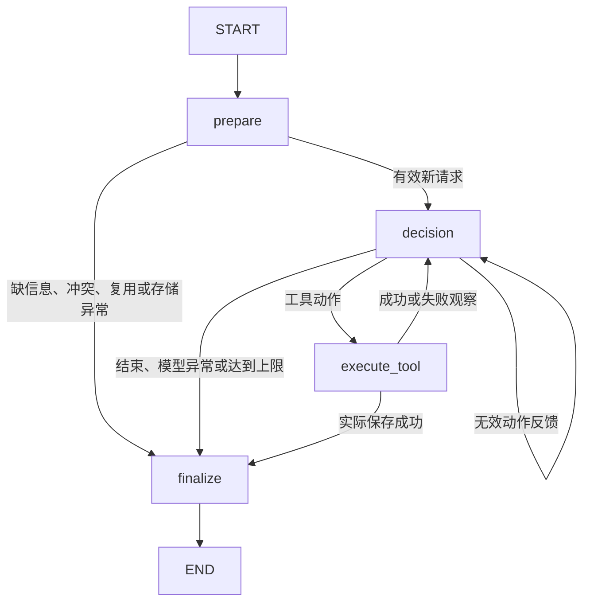

# LangGraph 方案与迁移范围

## 为什么改为 LangGraph

在原生版本上学习显式图状态、节点职责、条件边和检查点，同时继续复用工具、模型接口、幂等存储及 CLI。LangGraph 负责执行路由与状态更新，模型仍负责业务选择；使用框架本身不证明真实模型效果。

实际验证版本：Python 3.11.7，LangGraph 1.2.9、langgraph-checkpoint 4.1.1（均已锁定），运行环境中 langchain-core 为1.5.0。未使用 LangChain 模型封装、预构建 Agent 或内置 ToolNode，四个业务工具继续使用现有 JSON 动作协议。

## 四节点 StateGraph

| 节点 | 职责 |
|---|---|
| prepare | 输入校验、请求登记、冲突检测、复用已保存方案 |
| decision | 检查业务上限，调用模型，校验一个工具/结束动作 |
| execute_tool | 调用模型选中的工具，记录观察，返回状态增量 |
| finalize | 补充约束缺口、实际运行时间、框架版本等最终输出 |

节点与边在 `src/agent.py` 中通过 `StateGraph`、`add_node`、`add_edge`、`add_conditional_edges` 定义，编译后调用 `graph.invoke()`。没有用 Python while 循环在外部驱动模型和工具。路由函数只检查终止状态及是否存在有效工具动作，预算超限或工具失败不会自动选定替代计划或重试。

由编译后图实际导出的 Mermaid 文件见 [agent-graph.mmd](agent-graph.mmd)。

正常路径实际为 prepare → decision → execute_tool，随后重复模型/工具节点直到保存，最后 finalize。每次节点执行都产生 `node_events`；每个动作与实际工具观察组合为一条 Trace。工具失败也产生观察，下一次模型输入包含错误和此前成功产物。

## State 与更新

`src/state.py` 的 `GraphState` 是权威状态：

- 需求：raw_request、规范化 request。
- 业务：current_plan、plan_version、latest_estimate、save_result。
- 执行：pending_action、pending_event、last_observation、status、reason。
- 历史：steps、errors、trace、node_events。
- 计数：model_calls、execution_count、tool_calls。
- 运行：run_id、开始时间、metadata。

历史列表使用 `Annotated[list, operator.add]` reducer，节点仅返回新增项。其他字段覆盖更新。节点不原地修改输入；工具调用前转换为独立 TaskState，工具结果再转换为图状态更新。TaskState 是保留旧工具接口的临时结构，不另行维护一个 Agent 状态循环。

成功生成新方案时版本递增，旧估算立即置空；生成失败保留原方案。估算结果绑定方案版本和指纹。`steps` 记录工具成功/失败；`current_plan.business_steps` 记录待执行的素材准备、制作和审核，状态保持 planned。

## 保留的工具和约束

- search_materials：关键词检索合成素材，可排除 ID、改写查询。
- generate_script：按素材和内容形式生成本地模板脚本、引用和业务计划。
- estimate_plan：从规则计算最终计划业务费用、串行分钟数，返回两个约束及缺口。
- save_plan：只接受状态中的方案，要求最新有效估算，并重新核对规则与约束，实际写入成功才返回 saved=true。

预算不包含废弃方案、Agent 调用或 API 费用；耗时不包含程序运行时间。规则和素材继续由 `data/` 配置。原有四个业务工具及保存校验没有重写。

## 计数与终止

每次模型尝试计入 model_calls；每个返回动作计入 execution_count，包括无效动作与结束动作。工具尝试单独计数。decision 在开始新模型调用前检查两项业务上限，超限返回 incomplete。

已在最后一次额度内选出的工具仍然执行；若实际保存成功，则 completed。模型宣称完成但没有实际保存时仍是 incomplete。

图 super-step 与业务步数不是同一计数。根据最多每动作两个节点、加准备与收尾节点，派生设置 `recursion_limit` 作为额外兜底。发生 GraphRecursionError 时读取最近检查点，保留最后成功产物并明确返回 incomplete；若模型已选择工具但尚未执行，在 Trace 标记 not_executed。该兜底不伪装为 finalize 节点执行，也不自动重跑节点。

## 内存检查点与业务幂等

使用 `builder.compile(checkpointer=InMemorySaver())`。每次 run 生成独立 UUID，通过 config.configurable.thread_id 传入；它与用户 request_id 不同。

- run_id/thread_id：本次图状态和历史隔离。
- request_id：原有 JSON 存储中的业务请求绑定及重复保存防护。

检查点可通过 `agent.graph.get_state(agent.last_config)`、`get_state_history(...)` 在同一进程读取。测试实际检查待执行节点、当前方案、估算失效、失败观察及最终状态，验证新 Saver 无旧状态。

**本版本没有实现断点恢复。** InMemorySaver 随进程退出丢失；模型对象、Mock 动作游标、故障注入标记和外部写入副作用没有被检查点自动恢复。工具错误被捕获后继续交给模型，是当前图运行内的错误处理，不称为故障恢复。API 调用与文件副作用也没有仅凭检查点获得 exactly-once 保证。

业务幂等仍使用独立 JSON 文件：同 ID 同输入直接复用，相同 ID 不同输入返回 conflict。复用结果中的 steps 来自已保存的历史；本次 Trace 和节点事件只包含实际复用过程。未保存的相同请求可重跑，但会从头开始。

## 与原生版本的实际差异

| 项目 | 原生版本 | 当前版本 |
|---|---|---|
| 执行驱动 | Python while | 编译后的 StateGraph |
| 状态更新 | 修改 TaskState | 节点返回增量，reducer合并 |
| 路由 | 循环内部判断 | 显式 Conditional Edges |
| 图检查点 | 无 | 进程内状态及历史快照 |
| 业务、模型、幂等 | 原有实现 | 继续复用 |
| 恢复 | 无 | 未实现，未宣称 |
| 真实模型效果 | 当时未验证 | 已采集两条DeepSeek路径，样本有限 |

## DeepSeek 接入补充

沿用原有模型适配器，不增加 Agent 节点。CLI 可显式加载本地 `.env`，保留进程环境变量优先级。增加可选 thinking 参数，当前 DeepSeek 测试关闭思考模式，继续使用 JSON 动作协议。记录服务响应ID、模型名、finish_reason与usage；不保存reasoning_content。空白或截断响应明确失败，不自动补调用。当前只实测了 DeepSeek，不把其他兼容服务视为已验证。

官方参考：[Graph API](https://docs.langchain.com/oss/python/langgraph/graph-api)、[状态更新与循环](https://docs.langchain.com/oss/python/langgraph/use-graph-api)、[持久化边界](https://docs.langchain.com/oss/python/langgraph/persistence)。
